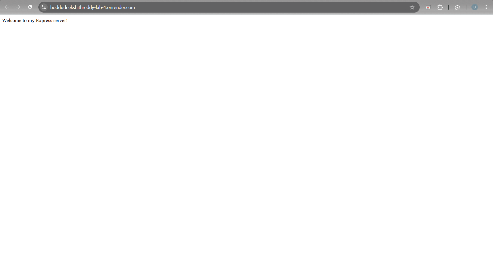
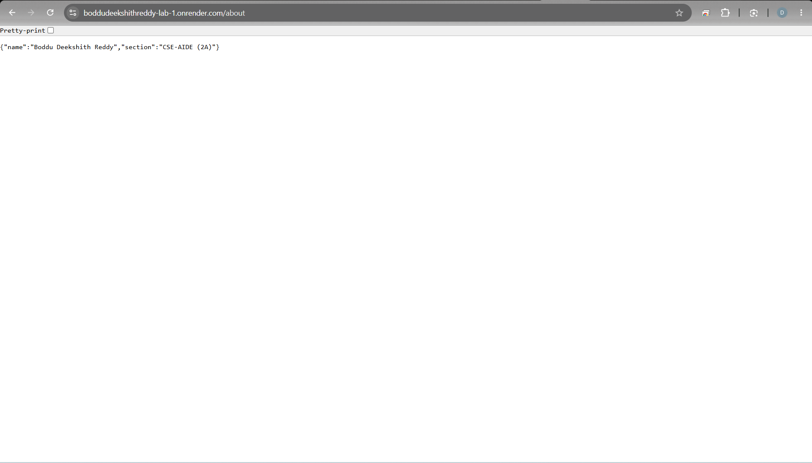
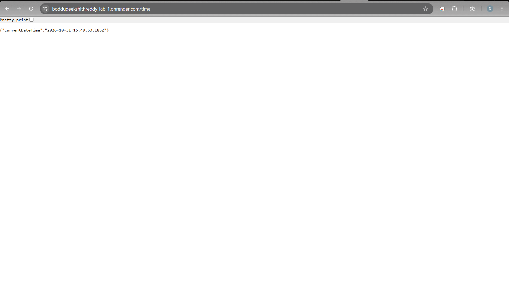
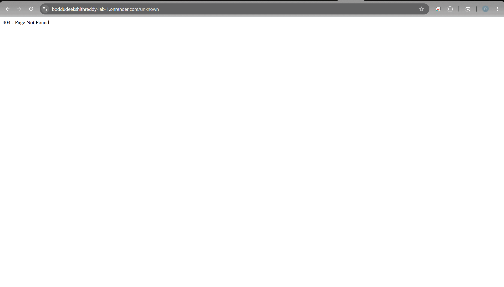

# Lab 01: Node.js and Express Server

## Student Information

| Field | Details |
|---|---|
| Student Name | Boddu Deekshith Reddy |
| Section | CSE-AIDE (2A) |
| Subject | Backend Development Fundamentals |
| Lab Number | 01 |
| Lab Title | Node.js and Express Server |

---

## 1. Objective

To set up a Node.js project and build a web server using the built-in HTTP module and Express.js framework.

The objective is to understand server creation, HTTP request and response handling, routing, JSON responses, current date and time generation, and 404 error handling.

## 2. Technologies Used

- Node.js
- Express.js
- JavaScript
- NPM (Node Package Manager)
- Visual Studio Code
- Google Chrome

## 3. Project Structure

```text
Lab-1/
│
├── screenshots/
│   ├── node-server.png
│   ├── express-server.png
│   ├── home.png
│   ├── about.png
│   ├── time.png
│   └── not-found.png
│
├── app.js
├── plain-server.js
├── package.json
├── package-lock.json
├── .gitignore
└── README.md
```

## 4. Installation and Setup

### Prerequisites

- Node.js installed
- NPM installed
- Visual Studio Code

### Step 1: Initialize the project

```bash
npm init -y
```

### Step 2: Install Express.js

```bash
npm install express
```

### Step 3: Verify installation

```bash
node -v
npm -v
```

## 5. Implementation

### A. Node.js HTTP Server

**File:** `plain-server.js`

Created a basic HTTP server using Node.js's built-in HTTP module.

**Command to run:**

```bash
npm run start:http
```

**Server URL:**

https://boddudeekshithreddy-lab-1.onrender.com

**Expected output:**

```text
Hello
```

### B. Express.js Server

**File:** `app.js`

Created an Express.js application to handle HTTP GET requests and return appropriate responses.

**Command to run:**

```bash
npm start
```

**Server URL:**

https://boddudeekshithreddy-lab-1.onrender.com

## 6. API Endpoints

| HTTP Method | Endpoint | Description | Status Code |
|---|---|---|---|
| GET | `/` | Displays welcome message | 200 |
| GET | `/about` | Returns student name and section in JSON | 200 |
| GET | `/time` | Returns current date and time | 200 |
| GET | `/unknown` | Handles unknown routes | 404 |

## 7. Output Screenshots

### 7.1 Node.js HTTP Server

The basic Node.js server successfully responds with the Hello message.



### 7.2 Express Server

The Express server starts successfully and listens on port 3000.


### 7.3 Home Route

**URL:** `https://boddudeekshithreddy-lab-1.onrender.com`

**Expected response:**

```text
Welcome to my Express server!
```


### 7.4 About Route

**URL:** `https://boddudeekshithreddy-lab-1.onrender.com/about`

**Expected response:**

```json
{
  "name": "Boddu Deekshith Reddy",
  "section": "CSE-AIDE (2A)"
}
```



### 7.5 Time Route

**URL:** `https://boddudeekshithreddy-lab-1.onrender.com/time`

**Expected response:**

```json
{
  "currentDateTime": "Automatically generated date and time"
}
```

The current date and time are generated dynamically using JavaScript's `new Date()` method.



### 7.6 404 Error Handling

**URL:** `https://boddudeekshithreddy-lab-1.onrender.com/unknown`

**Expected response:**

```text
404 - Page Not Found
```



## 8. Concepts Learned

1. Creating a Node.js project using NPM.
2. Understanding `package.json` and `node_modules`.
3. Installing Express.js.
4. Creating an HTTP server using `http.createServer()`.
5. Creating an Express application using `express()`.
6. Handling HTTP requests and responses.
7. Implementing GET routes using `app.get()`.
8. Sending JSON responses using `res.json()`.
9. Generating current date and time using `new Date()`.
10. Handling unknown routes using HTTP 404 status codes.

## 9. Problems Faced and Solutions

### Problem 1: PowerShell Execution Policy

NPM commands were blocked because PowerShell restricted script execution.

**Solution:** Used `npm.cmd` instead of `npm` to execute NPM commands.

### Problem 2: Port Already in Use

The server returned an EADDRINUSE error because another server was already running on port 3000.

**Solution:** Stopped the previously running server using `Ctrl + C` before starting another server.

## 10. Result

Successfully created and executed a Node.js HTTP server and an Express.js server.

Implemented the home, about, and time routes with appropriate HTTP status codes. Successfully tested all routes and implemented 404 error handling for unknown paths.

## 11. Author

**Boddu Deekshith Reddy**

Section: CSE-AIDE (2A)

Subject: Backend Development Fundamentals

Lab 01: Node.js and Express Server

---

*Backend Development Fundamentals – Laboratory Submission.*